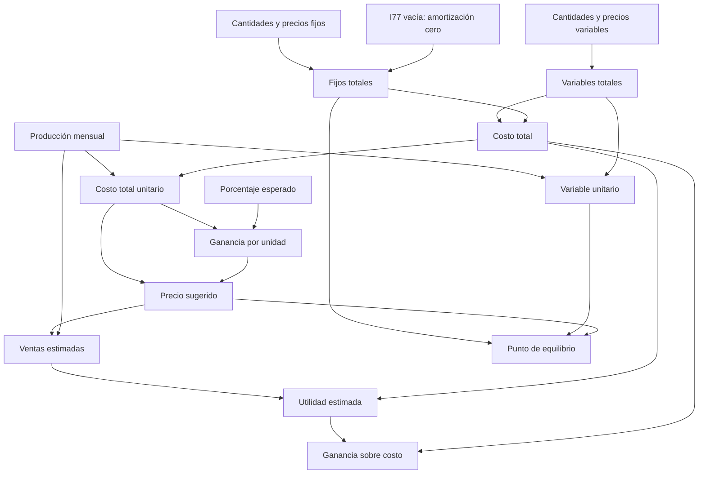

# Análisis funcional del Excel de INCUPO

Fecha de revisión: 28 de septiembre de 2026. Alcance: primera etapa solicitada, sin implementación de la aplicación.

**Actualización posterior al análisis:** el usuario resolvió la amortización: se carga manualmente como costo fijo mensual normal (cantidad 1, precio igual al importe mensual). No se reconstruye una fórmula de depreciación ni se usa I77. Las referencias a decisiones pendientes más abajo describen el estado del análisis original; esta decisión las reemplaza. La implementación inicial y su validación se documentan en el README.

## 1. Fuente y método

La carpeta contenía únicamente `NUEVA PLANILLA DE COSTOS  PAN ultimo (1).xlsx` (21.612 bytes). No había aplicación Flutter, README ni repositorio `.git` local. El original permanece intacto en la raíz.

Se inspeccionó el paquete XML completo del XLSX: hojas, celdas, estilos, fórmulas compartidas, valores guardados, combinaciones de celdas, relaciones y dibujos. Se expandieron las fórmulas compartidas y se recalcularon sus dependencias mediante un script de auditoría independiente. No se abrió ni recalculó el archivo con Excel. No se realizó una revisión visual renderizada; las referencias y conclusiones se basan en la estructura y contenido del archivo.

Resultado: **55 celdas con fórmulas, todas coincidentes con los valores guardados**, con tolerancia absoluta de 1e-8 o relativa de 1e-12. No hay ciclos en las dependencias evaluadas ni errores de fórmula guardados. Esto verifica el caso actual; no convierte las referencias dudosas en reglas correctas.

El [inventario completo](inventario_excel.md) contiene todas las celdas con contenido, las 55 fórmulas expandidas, las referencias a vacíos y la comparación individual. [La auditoría JSON](auditoria_excel.json) conserva también estilos y celdas vacías almacenadas. Se reproduce con `python tools/analizar_excel.py` (Python 3, biblioteca estándar).

SHA-256 del original: `1f06ff91b8b4803d751a500dae819183eaaf022937de40dfe59b108ae0db3001`.

## 2. Hojas y propósito

| Hoja | Contenido | Fórmulas |
|---|---|---:|
| COSTOS VARIABLES | Producción mensual, costos variables y fijos, costo unitario, ganancia esperada, precio, ventas y utilidad. El nombre no describe todo su contenido. | 50 |
| PUNTO EQUILIBRIO | Recupera costos fijos, precio y costo variable unitario de la primera hoja; calcula la cantidad necesaria para cubrir costos. | 5 |

Ambas hojas son visibles, sin filas ni columnas ocultas. Los rangos declarados son B1:L113 y B2:E20; el contenido de celdas llega a la fila 75 y 17 respectivamente. No se encontraron hojas adicionales, macros, tablas estructuradas, tablas dinámicas, gráficos, nombres definidos, vínculos externos, comentarios, validaciones de datos ni protección de hoja. Los dibujos son flechas y un título, no lógica de negocio. Hay estilos de protección por celda, pero no una protección activa que impida editar fórmulas.

## 3. Qué ingresa el usuario

La instrucción B4 pide completar casilleros verdes. El color ayuda, pero no define por sí solo el rol: por ejemplo, el resultado del equilibrio también tiene fondo verde. Las entradas se identificaron además por etiquetas y dependencias.

Todas las referencias de esta sección corresponden a `COSTOS VARIABLES`.

| Entrada | Celdas | Estado y significado |
|---|---|---|
| Producto | D12 | Casillero verde vacío. El producto del ejemplo aparece por separado en I24: `PAN (KG)`. |
| Cantidad producida por mes | G12 | 1560. Debe ser mayor que cero para los costos unitarios. |
| Nombre de insumo / gasto variable | B22:B44 | Descripciones editables; B34 funciona como rótulo de subgrupo, aunque también tiene cantidad y precio asociados. |
| Cantidad y precio por insumo / gasto variable | C22:D44 | Se multiplican fila por fila. Deben corresponder al consumo del mes. |
| Concepto fijo | B54:B63 | Ejemplos editables; la fila 60 tiene tratamiento especial. |
| Cantidad y precio de costos fijos | C54:D59 y C61:D63 | Se multiplican fila por fila. Algunos están vacíos y actualmente aportan cero. |
| Ganancia esperada sobre costo | K10 | Valor interno 0,04; se muestra como 4,00 %. |

**No son entradas independientes:** totales E, costo unitario C75, precio K16, cantidad vendida J24, precio de venta K24, utilidad J36 y porcentaje J38. En particular, J24 y K24 ya son fórmulas, aunque algunos estilos permitan editarlos.

**Unidad del producto:** no existe una celda específica. Se menciona en E12:F12 (`kg, unidad, docenas, litros, etc.`), en I24 (`PAN (KG)`) y D13 de la segunda hoja (`KG DE PAN`). Para Flutter se propone un campo explícito: kg, unidad, docena, litro y otra. Metro está en la consigna como posibilidad, pero no se identifica como unidad específica en el Excel; puede ingresarse como otra.

**Unidades de insumos:** están dentro de las descripciones: bolsa de harina de 25 kg, paquete de levadura de 20 gs, sal y grasa en kg, tubo de gas de 45 kg. No hay conversión automática de gramos, kilos, paquetes o rendimientos. Por ejemplo, 48 es cantidad de bolsas de harina, no kilos. Combustible y jornales no explicitan su unidad: no se puede inferir con certeza litros, horas o días.

**Período:** mensual. B9 propone multiplicar la producción semanal por 4; B10 propone multiplicar la diaria por los días producidos en el mes. Son instrucciones de texto, no fórmulas implementadas. No corresponde agregar un conversor obligatorio al MVP.

**Moneda:** la planilla usa `$` y menciona pesos; no declara código ISO. Formato argentino según la consigna. No hay reglas de inflación, impuestos porcentuales, descuentos ni tipos de cambio.

## 4. Fórmulas reales y orden de cálculo

Las fórmulas de la siguiente tabla pertenecen a `COSTOS VARIABLES`. El signo inicial `+` es parte de la expresión original y no cambia el cálculo. `r` representa cada fila del rango indicado.

| Resultado | Celda / rango | Fórmula real |
|---|---|---|
| Total de cada variable | E22:E44 | `=+Cr*Dr` |
| Variables totales (CVT) | E45 | `=SUM(E22:E44)` |
| Variable unitario (CVU) | E46 | `=+E45/G12` |
| Total fijo del propietario | E54 | `=+C54*D54` |
| Otros totales fijos | E55:E59 y E61:E63 | `=+Cr*Dr` |
| Amortización | E60 | `=+I77` (I77 está vacía) |
| Fijos totales (CFT) | E64 | `=SUM(E54:E63)` |
| Variables en resumen | C71 | `=+E45` |
| Fijos en resumen | C72 | `=+E64` |
| Costo total (CT) | C73 | `=SUM(C71:C72)` |
| Costo total unitario (CTU) | C75 | `=+C73/G12` |
| Ganancia por unidad | K11 | `=+C75*K10` |
| Precio por unidad | K16 | `=+C75+K11` |
| Cantidad de venta estimada | J24 | `=G12` |
| Precio de venta estimado | K24 | `=+K16` |
| Venta del producto | L24 | `=+J24*K24` |
| Ventas mensuales totales | L28 | `=SUM(L24:L27)` |
| Ventas en resultados | J34 | `=+L28` |
| Costos en resultados | J35 | `=+C73` |
| Utilidad | J36 | `=+J34-J35` |
| Ganancia lograda sobre costo | J38 | `=+J36/J35` |

En `PUNTO EQUILIBRIO`:

| Celda | Fórmula real | Papel |
|---|---|---|
| C9 | `=+'COSTOS VARIABLES'!C72` | Costos fijos |
| C10 | `=+'COSTOS VARIABLES'!K16` | Precio por unidad |
| C11 | `=+'COSTOS VARIABLES'!E46` | Variable unitario |
| D10 | `=+C10-C11` | Aporte de cada unidad para cubrir los costos fijos; no tiene etiqueta. |
| C13 | `=+C9/(C10-C11)` | Punto de equilibrio en la unidad del producto |

D10 es auxiliar: C13 repite su resta, no referencia D10. Las únicas referencias entre hojas son las tres anteriores y van de la primera hoja a la segunda. No hay referencias de vuelta.



**Interpretación del porcentaje:** la ganancia se agrega al costo; no es un margen sobre el precio de venta. La entrada 4 % se convierte una sola vez a 0,04. La utilidad mensual incluye el efecto de haber contabilizado previamente la remuneración del propietario como costo fijo: no deben sumarse ni descontarse nuevamente esos $850.000.

**Ventas:** la planilla supone que se vende toda la producción al precio sugerido. Bajo ese supuesto, con costo total positivo, J38 devuelve el mismo porcentaje esperado de K10 (salvo precisión numérica). No mide una rentabilidad real registrada. No hay campos funcionales independientes para ventas efectivas, stock sin vender ni otro precio de venta.

## 5. Caso completo del archivo para futuras pruebas

Producto del ejemplo: pan; unidad: kg; producción mensual: 1560; ganancia esperada: 0,04. D12 está vacía: el nombre y unidad provienen de las etiquetas I24 y `PUNTO EQUILIBRIO!D13`.

| Fila | Variable | Cantidad | Precio | Total |
|---|---|---:|---:|---:|
| 22 | Harina Bolsa 25 kg | 48 | 21.900 | 1.051.200 |
| 23 | Levadura seca 20 gs | 192 | 950 | 182.400 |
| 24 | Sal kg | 24 | 1.500 | 36.000 |
| 25 | Grasa kg | 120 | 4.450 | 534.000 |
| 26 | Gas tubo 45 kg | 1 | 69.000 | 69.000 |
| 27 | Bolsitas | 1560 | 45 | 70.200 |
| 35 | Combustible | 10 | 2.045 | 20.450 |
| 39 | Jornales Temporales | 72 | 5.830 | 419.760 |

Las filas variables 28:34, 36:38 y 40:44 tienen cantidad y precio cero. Entre ellas aparecen Otros costos Variables, Servicios, Viáticos y Transporte; las restantes no tienen descripción. Se conservan en el inventario, pero no deben crear requisitos obligatorios ni filas vacías en la app.

| Fila | Fijo | Cantidad | Precio | Total |
|---|---|---:|---:|---:|
| 54 | Remuneración del propietario | 1 | 850.000 | 850.000 |
| 55 | Remuneración empleados fijos | vacía | vacío | 0 |
| 56 | Seguros (Incendio) | 1 | 9.500 | 9.500 |
| 57 | Servicios (Luz, Agua, etc.) | 1 | 75.000 | 75.000 |
| 58 | Impuestos Específicos - Monotributo | 1 | 63.000 | 63.000 |
| 59 | Alquileres | 1 | 150.000 | 150.000 |
| 60 | Amortización de bienes (#) | no utilizada | no utilizado | 0, desde I77 vacía |
| 61:62 | Sin concepto | vacía | vacío | 0 |
| 63 | Otros | vacía | vacío | 0 |

Todos los nombres, importes, cantidades y el 4 % pertenecen al ejemplo, no son constantes de negocio ni valores obligatorios para nuevos cálculos. B17 instruye expresamente cambiar los ítems de ejemplo.

| Resultado | Valor para comparar sin redondeos intermedios | Presentación argentina |
|---|---:|---|
| Variables totales | 2383010 | $ 2.383.010,00 |
| Fijos totales | 1147500 | $ 1.147.500,00 |
| Costo total | 3530510 | $ 3.530.510,00 |
| Variable unitario | 1527.5705128205129 | $ 1.527,57 / kg |
| Costo total unitario | 2263.147435897436 | $ 2.263,15 / kg |
| Ganancia por unidad | 90.52589743589745 | $ 90,53 / kg |
| Precio sugerido | 2353.6733333333336 | $ 2.353,67 / kg |
| Ventas mensuales | 3671730.4000000004 | $ 3.671.730,40 |
| Utilidad mensual | 141220.40000000037 | $ 141.220,40 |
| Ganancia lograda | 0.040000000000000105 | 4,00 % |
| Precio menos variable unitario | 826.1028205128207 | $ 826,10 / kg |
| Punto de equilibrio | 1389.0522723160118 | 1.389,05 kg |

No se detectaron discrepancias en este caso. Esta auditoría Python no es todavía una prueba de Dart: al implementar habrá que ejecutar los mismos datos contra `CalculadoraService`.

## 6. Redondeo y validación

No hay `ROUND`, `ROUNDUP`, `CEILING` ni equivalentes en las fórmulas. Los valores monetarios tienen formatos con dos decimales; K10 y J38 tienen porcentaje con dos decimales, y el equilibrio C13 usa `0.00`. El formato no modifica la precisión de cálculo.

En la app se propone conservar precisión interna con `double` y redondear al mostrar. La venta estimada del archivo usa el precio completo; si se multiplicara el precio mostrado $2.353,67 por 1560, se obtendrían $3.671.725,20, es decir $5,20 menos que la planilla. No cambiar silenciosamente esa política. La pantalla y PDF pueden aclarar que los totales se calculan sin redondeos intermedios.

El Excel no valida entradas ni evita divisiones por cero. Las validaciones de la consigna deben añadirse al motor y formularios: producto y unidad requeridos, producción finita > 0, cantidades y precios finitos >= 0, campos completos en cada ítem agregado, porcentaje finito y resultado finito. Se propone porcentaje >= 0 por tratarse de ganancia esperada; no hay fundamento en el archivo para limitarlo a 100 %. Confirmar si se necesitan escenarios de pérdida antes de habilitar negativos.

Si el costo total es cero, la ganancia lograda no se puede dividir por ese costo. Si precio menos costo variable unitario <= 0, el equilibrio debe informarse como no calculable, con explicación, no como cero. Con costo fijo cero y aporte por unidad positivo, el equilibrio sí es cero. No confundir listas vacías permitidas con un ítem agregado que quedó incompleto.

Para kg, litros y otras medidas divisibles, conservar el equilibrio fraccionario. Para unidades indivisibles, redondear hacia arriba sería una decisión de presentación nueva: el Excel no la implementa. No afirmar que vender un entero redondeado hacia abajo alcanza para cubrir costos.

## 7. Vacíos, inconsistencias y dudas

1. **Amortización sin cálculo disponible:** E60 referencia I77, que está vacía y no es un campo de entrada identificado. No existe tabla de bienes, vida útil, valor residual ni fórmula de depreciación. Excel devuelve cero y subestima costos si debería haber amortización. C60/D60 no alimentan E60. Es la única excepción al producto cantidad × precio de los fijos. Antes de implementar esta parte, resolver si se cargará un importe mensual manual como costo fijo o si falta una sección del archivo. No inventar su fórmula ni reproducir el cero silencioso.
2. **Producto desconectado:** D12 está vacía; I24 tiene `PAN (KG)` como texto fijo y `PUNTO EQUILIBRIO!D13` tiene `KG DE PAN`. Cambiar el producto no actualiza esas etiquetas. La app debería compartir nombre y unidad desde un único modelo.
3. **Filas de ventas sobrantes:** L28 suma L24:L27, pero L25:L27 están vacías y no tienen fórmulas de ventas. El título B2 indica trabajar un producto a la vez. No se justifica convertir esto en un sistema multiproducto.
4. **Vacíos opcionales tratados como cero:** E55 lee C55/D55; E61:E63 leen C61:D63, todos vacíos. Son espacios sin datos, no errores aritméticos actuales. En una app se omiten ítems no cargados y se validan los que el usuario agregue.
5. **Falta de protección matemática:** producción cero rompe E46/C75 y dependientes; CT cero rompe J38; aporte unitario cero rompe C13 y negativo da un equilibrio sin interpretación útil. No hay `IF` ni controles equivalentes.
6. **Instrucciones desactualizadas:** B4 anuncia cuatro pasos, pero hay seis. Hay errores ortográficos en rótulos. La app no debería copiar esas instrucciones literalmente.
7. **Servicios en ambas categorías:** aparecen como variables en B36 y fijos en B57. No prueba un doble conteo actual (B36 está en cero), pero conviene explicar al usuario cómo clasificar sus gastos y evitar cargar dos veces el mismo importe.
8. **Resultados estimados:** el nombre “ganancia lograda” puede sugerir una medición real. El modelo solo proyecta venta total de lo producido al precio calculado. Se propone “Ganancia estimada sobre tus costos”.
9. **Supuesto mensual:** no mezclar una tanda semanal de insumos con alquiler mensual. La app debe recordar el período en cantidad producida y costos. El archivo no distribuye costos comunes entre varios productos.
10. **D10 sin rótulo:** es un cálculo auxiliar válido y coincidente, no un nuevo dato que el usuario deba completar.

Las 12 referencias individuales a vacíos están enumeradas en el inventario. No se encontraron `#REF!`, vínculos rotos entre hojas, fórmulas compartidas desplazadas incorrectamente ni discrepancias numéricas en el caso guardado. Sí permanece la duda funcional de I77.

## 8. Modelo de datos propuesto para Flutter

Propuesta, no código definitivo:

| Modelo | Campos / responsabilidad |
|---|---|
| `ItemCosto` | `id`, `concepto`, `cantidad`, `precioUnitario`. Reutilizable en ambas listas. Los totales se calculan en el servicio, no se ingresan ni almacenan por duplicado. La descripción puede incluir la unidad de compra. |
| `CalculoCostos` | `producto`, `cantidadMensual`, `unidadProduccion`, `tasaGanancia` (fracción: 0,04), `costosVariables`, `costosFijos`. Un producto por cálculo. Período mensual explícito, sin selector adicional. |
| `ResultadoCalculo` | Totales por ítem, variables, fijos, total, variable unitario, total unitario, ganancia por unidad, precio sugerido, ventas mensuales, utilidad, ganancia sobre costo y punto de equilibrio. Los resultados no definidos llevan valor nullable y motivo comprensible. |
| `CalculoController` | Borrador en memoria, paso actual, agregar/editar/quitar ítems, validaciones y obtención de resultados. No persistencia ni servidor. |

No modelar cuentas de usuario, base de datos, productos históricos ni tablas de amortización sin especificación. Si se acuerda amortización manual mensual, podría cargarse como un costo fijo con cantidad 1; esa adaptación debe quedar documentada como decisión nueva y probarse por separado.

## 9. Arquitectura inicial propuesta

```text
lib/
  main.dart
  models/
    item_costo.dart
    calculo_costos.dart
    resultado_calculo.dart
  services/
    calculadora_service.dart
    pdf_service.dart
  state/
    calculo_controller.dart
  screens/
    inicio_screen.dart
    producto_screen.dart
    costos_variables_screen.dart
    costos_fijos_screen.dart
    ganancia_screen.dart
    resultado_screen.dart
  widgets/
    campo_numerico.dart
    item_costo_card.dart
    indicador_pasos.dart
    boton_principal.dart
  utils/
    formatters.dart
    validators.dart
test/
  calculadora_service_test.dart
  fixtures/caso_pan.dart
docs/
  analisis_excel.md
  inventario_excel.md
```

`CalculadoraService` será Dart puro, sin Flutter ni acceso a archivos. Recibirá datos validados y aplicará las operaciones trazadas arriba. `PdfService` recibirá el cálculo, resultado y fecha, sin recalcular reglas por su cuenta. La interfaz de compartir/guardar/imprimir podrá usar `printing`; el documento, `pdf`, con recursos locales para funcionar offline. La elección de versiones y configuración Android corresponde a la etapa de implementación.

Estado simple con `ChangeNotifier` y un controlador de alcance del asistente; no hace falta una biblioteca adicional. Volver a un paso conserva datos en memoria. Cerrar el proceso no conserva historial; el PDF es la copia que el usuario decide guardar. El original permanecerá en el proyecto. Git, `.gitignore`, commits y README de ejecución se prepararán al comenzar la implementación; todavía no hay comandos Flutter ejecutables ni APK.

## 10. Flujo de pantallas propuesto

**Inicio → Producto → Variables → Fijos → Ganancia → Resultados → PDF.**

1. Inicio: identidad INCUPO, explicación breve y “Iniciar cálculo”.
2. Producto: nombre, cantidad producida **por mes** y unidad; ejemplo de unidad sin precargar los datos de pan.
3. Variables: tarjetas de gastos con agregar, editar y eliminar. Formulario breve: concepto, cantidad, precio por la unidad de compra. Total automático. Ayuda sobre gastos que cambian al producir más.
4. Fijos: mismo patrón; ayuda sobre gastos que se pagan aunque no se produzca. Resolver previamente cómo se tratará amortización.
5. Ganancia: porcentaje esperado con explicación “Se agrega sobre tus costos”. Sigue el orden conceptual de los pasos 2 y 3 del Excel y evita sobrecargar Producto.
6. Resultados: precio sugerido destacado; después costo unitario, utilidad mensual y equilibrio explicados. Un detalle desplegable reúne todos los demás resultados, sin ocultarlos definitivamente. Aviso: supone vender toda la producción del mes.
7. PDF: acción desde Resultados, con previsualización y capacidades de Android para compartir, imprimir o guardar como PDF. No necesita ser otro paso de ingreso de datos.

El asistente muestra cinco pasos de trabajo: Producto, Variables, Fijos, Ganancia y Resultados. Botones grandes, texto legible y navegación atrás sin pérdida de datos. No hay una pantalla extra obligatoria para repetir ventas o resultados intermedios del Excel.

## 11. Pruebas y decisiones para la siguiente etapa

Primero resolver la amortización; después implementar modelos, servicio y pruebas antes de pantallas. El caso de pan debe comparar cada resultado de la tabla anterior con tolerancia numérica y sin redondeos intermedios. Incluir sumas vacías, ceros permitidos, entradas negativas/no finitas, cantidad cero, costo total cero y equilibrio no calculable. Verificar específicamente que 4 % se normalice a 0,04 y no a 4 ni a 0,0004. Comprobar que los cambios de insumos o producción se propaguen a resultados, sin valores duplicados desactualizados.

Dudas a resolver con INCUPO antes de cerrar las reglas:

- ¿La amortización se ingresará como importe mensual conocido o falta el cuadro al que debía apuntar I77?
- ¿Se mantiene como en el Excel la hipótesis de vender todo al precio sugerido? La propuesta actual sí; admitir ventas parciales o precio elegido sería una ampliación.
- ¿Cómo presentar el equilibrio para unidades indivisibles? La fórmula se conserva; una cantidad mínima entera requeriría redondeo hacia arriba explícito.

No se necesita ampliar requisitos para empezar el motor confirmado; la excepción de amortización debe quedar resuelta antes de considerarlo completo.
